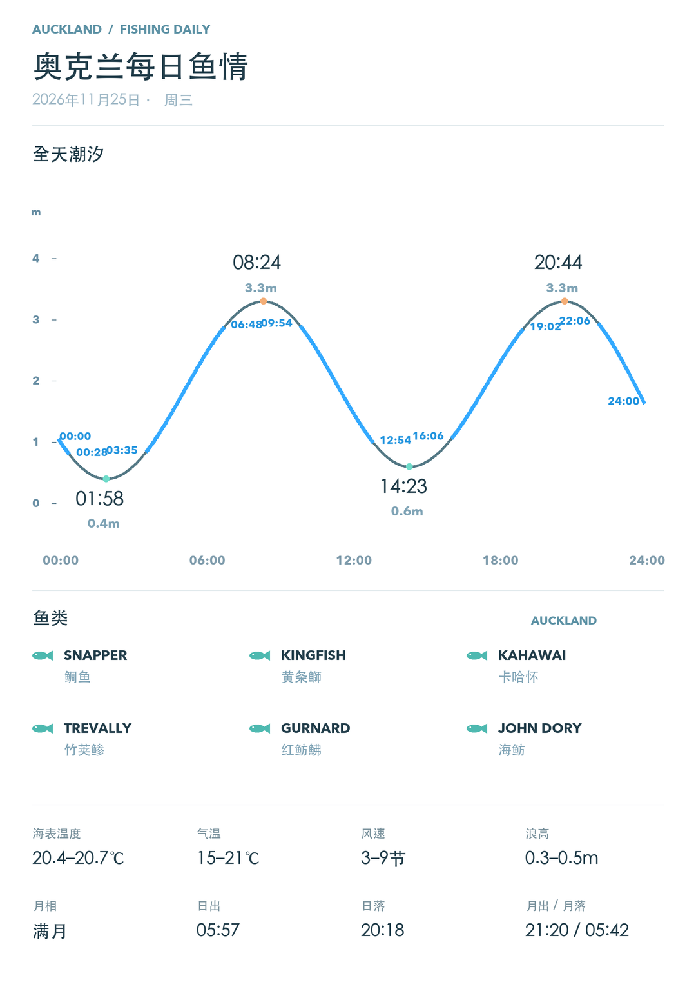

# Auckland daily fishing report

Runs daily at 06:00 Pacific/Auckland, with daylight saving handled by GitHub Actions. Scheduled runs may be delayed by GitHub. Manual runs are available from Actions.

Reports are saved in `reports/` and as workflow artifacts. No delivery channel is configured.

## Data and interpretation

- Tides: LINZ Auckland annual CSV, local standard/daylight time and chart datum. This differs from the Global Tide screenshot's coordinate model and OLAT datum.
- Curve: half-cosine interpolation between high/low predictions, not a direct minute-resolution hydrodynamic model.
- Blue windows: **reference estimate** where the absolute interpolated tidal height change exceeds 0.5 m/hour. This is NOT the Global Tide fish activity algorithm, a measured feeding rate, or a validated catch probability. Previous preview boundaries were approximated from a screenshot; those constants are not used here.
- Weather and sea temperature: Solot `getweatherall` endpoint; response `ftime` without timezone is interpreted as UTC, an assumption still requiring App comparison. Raw update times are retained in JSON.
- Sun/moon: Astral, Auckland location and Pacific/Auckland calendar date.
- Fish list: static common Auckland target species, not live school observations or daily detections.
- Data fetch failures fail the workflow instead of silently publishing old or invented values. Original authentication/device headers and proxy traffic are excluded.

## Local use

Python 3.12, `pip install -r requirements.txt`, install Noto CJK fonts, then `python fetch.py && python render.py`.
Set `REPORT_DATE=YYYY-MM-DD` to preview a date within the weather forecast range. Optional `FONT_CN` and `FONT_EN` override font paths.
